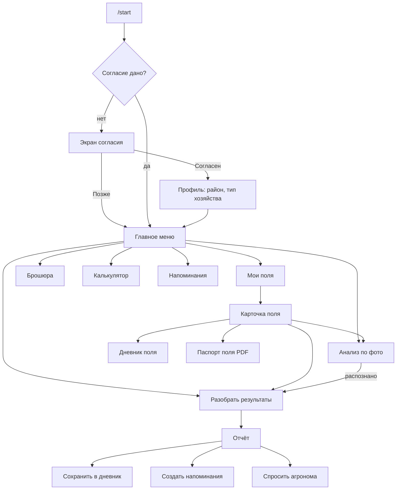

# Сценарии и экраны

Здесь описано, что видит пользователь на каждом шаге, какие кнопки нажимает и какие данные
сохраняются. Экраны MVP (мастер, брошюра, сочетания, калькулятор) уже реализованы в `mvp/screens.py`;
их поведение — эталон, менять его можно только осознанно.

## 1. Карта бота



## 2. Главное меню

```
ПочваСвет — что делать по результатам тестов
🟢 в норме · 🟡 обрати внимание · 🔴 действуй сейчас

[🌱 Мои поля]
[📷 Анализ по фото]          ← v2
[🧪 Разобрать результаты кнопками]
[📖 Брошюра]  [🔗 Сочетания]
[🧮 Калькулятор]  [⏰ Напоминания]
[📱 Интерактивная брошюра]   ← web_app, если задан WEBAPP_URL
```

Без согласия на обработку данных (FR-1.2) кнопки «Мои поля», «Анализ по фото», «Напоминания»
ведут на экран согласия.

## 3. Согласие и профиль (v1)

1. Экран согласия: короткий текст из `09_security_privacy.md` + кнопки `[Согласен]` `[Позже]` `[Подробнее]`.
2. После «Согласен»: выбор области (6 кнопок + Минск), затем района (список, по 8 на страницу, кнопки ◀ ▶).
3. Тип хозяйства: `[КФХ]` `[ЛПХ / огород]` `[Другое]`.
4. «Можно использовать ваши результаты обезличенно для карты почв района?» `[Да]` `[Нет]`.
5. Главное меню.

Список районов — справочник `districts` (код, область, название); заполняется миграцией из CSV.

## 4. Поля (v1)

### 4.1. Список

```
🌱 Мои поля (3)

🔴 За садом — 6 соток, супесь, картофель · разбор 12.04
🟢 Большое — 4,2 га, суглинок, озимая рожь · разбор 20.09
⚪ Огород — 2 сотки, песок, овощи · разборов нет

[За садом] [Большое] [Огород]
[➕ Новое поле]  [🏠 Меню]
```

### 4.2. Создание (FSM `FieldCreate`)

| Шаг | Вопрос | Ввод | Проверка |
| --- | --- | --- | --- |
| name | «Как назовём поле?» | Текст | 1–40 символов, без HTML |
| area | «Площадь?» | Кнопки (1/2/6/10/25 соток, 1/5/20 га) или текст «6 соток», «0,5 га», «600 м2» | Парсер площади → м²; 1 м² … 10 000 га |
| texture | «Механический состав?» | Кнопки или «Определить пробой “жгут”» | — |
| crop | «Что выращиваете?» | Кнопки grain/potato/veg | — |
| location | «Отправьте местоположение поля — для прогноза погоды» | Кнопка Telegram «Отправить местоположение» или `[Пропустить]` | Координаты в пределах Беларуси (51,2–56,2 с. ш., 23,1–32,8 в. д.), иначе переспросить |

### 4.3. Карточка поля

```
🔴 За садом
6 соток · супесь · картофель
Последний разбор 12.04: pH 4,6–5,0 🔴 · P II 🔴 · K II 🔴 · N 🟡

[🧪 Новый разбор] [📷 По фото]
[📒 Дневник] [📄 Паспорт поля]
[✏️ Изменить] [🗄 В архив]
[⬅️ К полям]
```

## 5. Мастер разбора (MVP → v1)

Поведение MVP (см. `mvp/screens.py::question_screen`), плюс в v1:

- запуск из карточки поля: `texture`, `crop`, `area` берутся из поля, шаги пропускаются (FR-3.3);
- после отчёта кнопки: `[💾 Сохранить в дневник]` `[⏰ Напоминания]` `[👩‍🌾 Спросить агронома]` (только если есть 🔴) `[📄 Паспорт]`;
- если у поля есть прошлый разбор — блок «Изменения с 20.09.2025: pH ↑ (ph2 → ph3), P = , K ↓».

Отчёт разбивается на сообщения ≤ 3800 символов в порядке: итог и предупреждения → план → «не покупать»
→ сочетания → карточки тестов → дисклеймер. Кнопки — под последним сообщением.

> В MVP сочетания идут после карточек. В v1 порядок меняется: сочетания выше карточек, потому что
> их рекомендации главнее.

## 6. Анализ по фото (v2)

```
Пользователь: [📷 Анализ по фото] → выбирает поле
Бот: инструкция (картинка-схема карты с подписанными лунками) + [▶️ Начать тесты] [📖 Как проводить тесты]
Пользователь: [▶️ Начать тесты]
Бот: чек-лист с таймерами:
     pH — залейте индикатор и нажмите [⏱ pH готов]      → через 1 мин «Можно фотографировать pH»
     Фосфор — добавьте реактив и нажмите [⏱ P начат]    → через 10 мин «Фосфор готов»
     Калий — [⏱ K начат]                                → через 5 мин
     Когда всё готово — положите планшет на карту и пришлите фото (лучше «как файл»).
Пользователь: присылает фото
Бот: «Проверяю фото…» (chat action upload_photo)
     ├─ плохое качество → что не так + как переснять (см. 06, раздел «Сообщения»)
     └─ ок → результаты:
          pH: 🔴 оранжево-красный (pH 4,6–5,0) · уверенность высокая
          Фосфор: 🟡 голубой (III) · уверенность средняя — [Верно] [Изменить]
          Калий: не удалось распознать — выберите вручную: [кнопки уровней]
          Нитраты: 🟢 ...
     [✅ Всё верно — к рекомендациям] [✏️ Исправить]
     → недостающие шаги мастера (карбонаты, пена, черви, навоз) → отчёт
```

Таймеры реализуются отложенными задачами (таблица `reminders` с `kind = timer`), а не `asyncio.sleep`,
чтобы переживать перезапуск бота.

## 7. Дневник (v1)

```
📒 Дневник: За садом
[➕ Внесение] [➕ Посев] [➕ Урожай] [➕ Заметка]

12.04.2026 · 🧪 Разбор — итог 🔴 (К1, К3, К4)            [Открыть]
15.04.2026 · 🧂 Внесение — аммофос 12 кг (6 соток)
20.09.2026 · 🌾 Урожай — 1 450 кг с участка
[◀ Ранее] [Позже ▶]   [⬅️ К полю]
```

«Внесение»: удобрение (кнопки из `rules.json → fertilizers` + «Другое» с вводом названия), количество
(кг на участок или кг/га), дата (сегодня / вчера / ввести ДД.ММ). Из отчёта: кнопка «Внёс по рекомендации»
создаёт черновик с количеством из отчёта, пользователь подтверждает или правит.

## 8. Напоминания (v1)

Создаются из отчёта по правилам `05_rules_engine.md`, раздел 6. Сообщение напоминания:

```
⏰ За садом: пора известковать.
Доломитовая мука ≈ 210 кг на участок, заделать при перекопке.
[✅ Сделано] [⏳ Через 3 дня] [✖️ Отменить]
```

«Сделано» для внесения создаёт запись в дневнике.

## 9. Вопрос агроному (v2)

Фермер: `[👩‍🌾 Спросить агронома]` → «Опишите вопрос одним сообщением, можно с фото» → отправляет.
Бот → в чат агронома района: карточка обращения (номер, район, поле, итог отчёта, ответы, фото, вопрос)
и кнопки `[Взять в работу]` `[Закрыть]`. Агроном отвечает reply на карточку → бот пересылает текст
фермеру с подписью «Ответ агронома». Статусы — в таблице `tickets`.

## 10. Схема callback_data

Формат `префикс:аргументы`, разделитель `:`, всего ≤ 64 байт. Идентификаторы в БД — целые числа.

| Префикс | Аргументы | Экран | Этап |
| --- | --- | --- | --- |
| `m` | — | Главное меню | MVP |
| `b`, `bi:<ind>`, `bl:<level>`, `bo:<light>`, `bc`, `bk:<combo>`, `bx:<budget\|calendar\|safety>` | | Брошюра | MVP |
| `w:start`, `w:back`, `w:<qid>:<value>`, `wk:<combo>` | `value` = id уровня или `-` (пропуск) | Мастер | MVP |
| `c:start`, `cf:<fert>`, `cd:<fert>:<dose>`, `ca:<fert>:<dose>:<area>` | | Калькулятор | MVP |
| `f:l:<page>` | | Список полей | v1 |
| `f:v:<field_id>` | | Карточка поля | v1 |
| `f:n` | | Новое поле | v1 |
| `f:e:<field_id>:<attr>` | attr: name, area, tex, crop, loc | Изменение | v1 |
| `f:a:<field_id>` / `f:ua:<field_id>` | | В архив / из архива | v1 |
| `fw:<field_id>` | | Мастер для поля | v1 |
| `rs:<analysis_id>` | | Сохранить разбор | v1 |
| `rr:<analysis_id>` | | Создать напоминания | v1 |
| `d:<field_id>:<page>` | | Дневник | v1 |
| `dn:<field_id>:<type>` | type: op, sow, hv, note | Новая запись | v1 |
| `do:<analysis_id>:<nutrient>` | | «Внёс по рекомендации» | v1 |
| `n:l:<page>`, `n:d:<rem_id>`, `n:s:<rem_id>`, `n:x:<rem_id>` | done / snooze / cancel | Напоминания | v1 |
| `p:f:<field_id>`, `p:t:<test>`, `p:ok:<photo_id>`, `p:fix:<photo_id>:<test>`, `p:set:<photo_id>:<level>` | | Анализ по фото | v2 |
| `q:new:<analysis_id>`, `q:take:<ticket_id>`, `q:close:<ticket_id>` | | Агроном | v2 |
| `pp:<field_id>` | | Паспорт PDF | v2 |
| `g:<step>:<value>` | | Согласие и профиль | v1 |
| `adm:<action>` | | Администрирование | v1 |

Проверка в тестах: обход всех экранов, каждая `callback_data` ≤ 64 байт (`tests/test_screens.py`).

## 11. Состояния FSM (aiogram)

| Группа | Состояния | Хранилище |
| --- | --- | --- |
| `Wizard` | данные: `answers`, `q`, `field_id`, `photo_id` | Redis |
| `FieldCreate` | `name`, `area`, `texture`, `crop`, `location` | Redis |
| `FieldEdit` | `value` | Redis |
| `DiaryEntry` | `fertilizer`, `amount`, `date`, `note` | Redis |
| `Calc` | `dose`, `reverse_amount` | Redis |
| `Ticket` | `question` | Redis |
| `Onboarding` | `region`, `district`, `farm_type`, `stats_consent` | Redis |

TTL состояний — 24 ч. При устаревшем нажатии бот отвечает «Этот шаг устарел» и показывает меню.

## 12. Ошибки и пустые состояния

| Ситуация | Что видит пользователь |
| --- | --- |
| Нет полей | «Полей пока нет. Добавьте первое — это займёт минуту.» `[➕ Новое поле]` |
| Нажата кнопка устаревшего сообщения | «Этот шаг устарел. Начните заново из меню.» + меню |
| Ввод текста там, где ждём кнопку | Повтор вопроса с подсказкой «Выберите вариант кнопкой ниже» |
| Ошибка сервера | «Что-то пошло не так, мы уже разбираемся. Попробуйте через минуту.» Ошибка логируется с `error_id`, он показывается пользователю |
| Пользователь заблокировал бота | Помечаем `users.is_active = false`, напоминания не отправляем |
