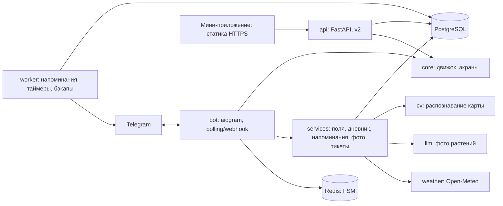

# Архитектура

## 1. Принципы

1. **Чистое ядро.** Расчёт рекомендаций (`core/`) — чистые функции без I/O, Telegram и БД. Его
   используют бот, мини-приложение (через JS-копию) и тесты.
2. **Правила — данные.** Всё агрономическое — в `rules/rules.json`, валидируется `rules/rules.schema.json`.
3. **Экраны отдельно от транспорта.** Функции экранов возвращают `Screen(text, buttons)`;
   обработчики aiogram только достают данные, вызывают экран и отправляют.
4. **Долгие операции — вне обработчика.** Распознавание фото и LLM — в пуле процессов/потоков,
   напоминания — в отдельном процессе-воркере.
5. **Всё переживает перезапуск.** FSM — в Redis, таймеры и напоминания — в PostgreSQL.

## 2. Стек

| Слой | Выбор | Почему |
| --- | --- | --- |
| Язык | Python 3.12 | Единый язык для бота, CV и скриптов |
| Бот | aiogram 3.x | Асинхронный, роутеры, FSM, middlewares |
| БД | PostgreSQL 16 | Надёжность, JSONB для ответов и отчётов |
| ORM / миграции | SQLAlchemy 2 (async, asyncpg) + Alembic | Стандарт |
| FSM и кэш | Redis 7 (`RedisStorage` aiogram) | Состояния переживают перезапуск |
| Распознавание | OpenCV (`opencv-contrib-python-headless`), NumPy, scikit-image (`deltaE_ciede2000`) | ArUco, гомография, цвет |
| PDF | reportlab + шрифт DejaVu Sans | Кириллица, без системных зависимостей |
| Графики в дневнике | matplotlib (Agg) → PNG | v2 |
| HTTP-клиент | httpx | Open-Meteo, LLM |
| API мини-приложения | FastAPI (v2) | Проверка `initData`, сохранение разбора |
| Конфигурация | pydantic-settings | Переменные окружения с типами |
| Тесты | pytest, pytest-asyncio, hypothesis (свойства ядра) | |
| Качество | ruff, mypy, pre-commit | |
| Развёртывание | Docker Compose на VPS | Просто для пилота |

## 3. Компоненты



## 4. Структура репозитория

```
pochvasvet/
├── CLAUDE.md / AGENTS.md          # правила для ИИ-агента
├── README.md
├── pyproject.toml                 # зависимости, ruff, mypy, pytest
├── docker-compose.yml
├── Dockerfile
├── .env.example
├── alembic.ini
├── migrations/                    # Alembic
├── rules/
│   ├── rules.json                 # агрономические правила (единый источник)
│   ├── rules.schema.json          # JSON Schema правил
│   └── calibration/               # калибровка распознавания по партиям реактивов (v2)
├── app/
│   ├── config.py                  # Settings (pydantic-settings)
│   ├── core/                      # ЧИСТОЕ ЯДРО: без I/O
│   │   ├── rules.py               # загрузка + валидация rules.json
│   │   ├── engine.py              # build_report, convert (перенос из mvp/engine.py)
│   │   ├── units.py               # парсер площади, форматирование чисел
│   │   └── reminders_plan.py      # отчёт → список напоминаний
│   ├── screens/                   # Screen(text, buttons); без aiogram
│   │   ├── common.py              # Screen, e(), dot(), пагинация
│   │   ├── menu.py, brochure.py, wizard.py, calc.py      # перенос из mvp/screens.py
│   │   ├── fields.py, diary.py, reminders.py, photo.py, tickets.py, onboarding.py
│   ├── bot/
│   │   ├── main.py                # сборка Bot, Dispatcher, роутеров, запуск
│   │   ├── keyboards.py           # Screen.buttons → InlineKeyboardMarkup
│   │   ├── middlewares.py         # сессия БД, пользователь, логирование, ошибки
│   │   ├── states.py              # StatesGroup
│   │   └── handlers/              # по одному роутеру на модуль ТЗ
│   │       ├── start.py, brochure.py, wizard.py, calc.py, fields.py, diary.py,
│   │       ├── reminders.py, photo.py, plants.py, tickets.py, admin.py, webapp.py
│   ├── db/
│   │   ├── models.py              # SQLAlchemy-модели (см. 04_data_model.md)
│   │   ├── session.py
│   │   └── repo/                  # запросы по сущностям
│   ├── services/
│   │   ├── fields.py, analyses.py, diary.py, reminders.py, tickets.py
│   │   ├── weather.py             # Open-Meteo + кэш 1 ч
│   │   ├── passport_pdf.py        # reportlab
│   │   └── llm.py                 # клиент мультимодальной модели (v3)
│   ├── cv/                        # распознавание (v2), см. 06_photo_recognition.md
│   │   ├── card.py                # геометрия карты, координаты зон
│   │   ├── detect.py              # ArUco, гомография
│   │   ├── quality.py             # резкость, экспозиция, блики
│   │   ├── color.py               # цветокоррекция, Lab, ΔE2000
│   │   ├── readers.py             # по одному «читателю» на тест
│   │   └── pipeline.py            # recognize(image_bytes, calibration) -> RecognitionResult
│   ├── worker/
│   │   └── main.py                # цикл: напоминания, таймеры, очистка, бэкап-триггер
│   └── api/                       # FastAPI для мини-приложения (v2)
├── webapp/                        # мини-приложение (перенос из mvp/webapp)
├── tools/
│   ├── build_webapp.py
│   ├── compare_engines.py
│   ├── make_card.py               # генерация PDF карты для печати (v2)
│   └── calibrate.py               # построение калибровки по размеченным фото (v2)
├── tests/
│   ├── core/, screens/, cv/, services/, bot/
│   └── fixtures/                  # эталонные ответы, фото карт
├── data/
│   └── districts.csv              # области и районы Беларуси
└── mvp/                           # исходный MVP (только для справки, удаляется после этапа 0)
```

## 5. Слои и зависимости

Разрешённые направления импорта (проверяются `import-linter` или тестом):

```
bot.handlers → screens, services, core
screens      → core
services     → db, core, cv, (llm, weather)
worker       → services, db
api          → services, core
core         → (ничего, кроме стандартной библиотеки)
cv           → numpy, opencv (без db и bot)
```

## 6. Ключевые потоки

### 6.1. Нажатие кнопки мастера

1. Middleware открывает сессию БД, загружает/создаёт `User`.
2. Обработчик читает FSM-данные (`answers`, `q`), обновляет ответ.
3. Если вопросы остались — `screens.wizard.question(q, answers)` → `edit_text`.
4. Иначе `core.engine.build_report(answers, month)` → `analyses` (черновик со снимком отчёта и
   `rules_version`) → `screens.wizard.report_messages(report)` → отправка.

### 6.2. Фото теста (v2)

1. Обработчик принимает `photo` или `document` (image/jpeg, image/png, ≤ 20 МБ), отвечает «Проверяю…».
2. Скачивает файл в память, сохраняет в хранилище (`storage/photos/<user>/<uuid>.jpg`, только с согласием).
3. `await loop.run_in_executor(process_pool, cv.pipeline.recognize, bytes, calibration)` — таймаут 15 с.
4. Результат → таблица `photo_analyses`; экран подтверждения; подтверждённые уровни → мастер.

### 6.3. Напоминания

Воркер раз в 60 с выполняет:

```sql
SELECT ... FROM reminders
WHERE status = 'scheduled' AND due_at <= now()
ORDER BY due_at LIMIT 50
FOR UPDATE SKIP LOCKED;
```

отправляет сообщения (не быстрее 25/с), ставит `status = 'sent'`; при `TelegramForbiddenError` —
`users.is_active = false`, напоминание `status = 'failed'`.

## 7. Конфигурация (`.env`)

| Переменная | Обязательна | Пример | Назначение |
| --- | --- | --- | --- |
| `BOT_TOKEN` | да | `123:ABC` | Токен бота |
| `DATABASE_URL` | да | `postgresql+asyncpg://bot:pass@db:5432/pochvasvet` | БД |
| `REDIS_URL` | да | `redis://redis:6379/0` | FSM |
| `WEBAPP_URL` | нет | `https://pochvasvet.example/index.html` | Мини-приложение |
| `ADMIN_IDS` | да | `11111111,22222222` | Telegram ID администраторов |
| `AGRONOMIST_FALLBACK_CHAT_ID` | v2 | `-1001234567890` | Общий чат агрономов |
| `RULES_PATH` | нет | `rules/rules.json` | Путь к правилам |
| `CALIBRATION_DIR` | v2 | `rules/calibration` | Калибровка |
| `PHOTO_STORAGE_DIR` | v2 | `/data/photos` | Фото |
| `LLM_API_KEY`, `LLM_MODEL` | v3 | — | Фото растений |
| `TZ_DEFAULT` | нет | `Europe/Minsk` | Часовой пояс напоминаний |
| `LOG_LEVEL` | нет | `INFO` | |
| `WEBHOOK_URL`, `WEBHOOK_SECRET` | нет | — | Если вместо polling нужен webhook |

## 8. Развёртывание

`docker-compose.yml`: сервисы `bot`, `worker`, `db` (postgres:16, том `pgdata`), `redis` (redis:7, AOF),
`api` (v2). Все с `restart: unless-stopped`. Бэкап: `pg_dump` по cron на хосте → архив, хранение 30 дней.

Минимальный VPS для пилота: 2 vCPU, 4 ГБ RAM, 40 ГБ SSD.

Режим: long polling на пилоте; webhook за nginx с TLS — при росте нагрузки.

## 9. CI (GitHub Actions)

На каждый push/PR: `ruff check`, `ruff format --check`, `mypy app/core app/screens`, `pytest`,
`python tools/compare_engines.py` (Node 20+), проверка `rules.json` по схеме, сборка Docker-образа.
Сборка `webapp/index.html` — артефакт workflow; публикация на GitHub Pages из `main`.

## 10. Наблюдаемость

- Логи JSON в stdout: `event`, `user_hash` (SHA-256 от Telegram ID с солью), `handler`, `duration_ms`, `error_id`.
- Метрики (v2, Prometheus-формат через `api`): число разборов, распределение итоговых сигналов,
  доля фото, отклонённых по качеству, средняя уверенность распознавания, время ответа.
- Ошибки: глобальный обработчик `dp.errors` → лог + сообщение администраторам (не чаще 1 раза в 5 минут на тип ошибки).
